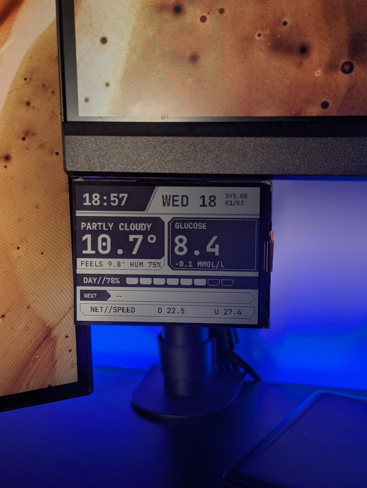

# Waveshare RLCD Home Assistant display

ESPHome dashboard for a Waveshare ESP32-S3 4.2-inch, 400 x 300 reflective LCD using the ST7305 driver.


The button cycles through three pages:

- **Dashboard:** clock/date, weather, live glucose, next calendar event, and download/upload speeds.
- **Weather:** temperature, feels-like temperature, humidity, wind, cloud cover, and UV index.
- **Glucose:** current reading, 5-minute change, 24-hour average/history graph, and sensor expiry.

Includes low/high glucose tones with a Home Assistant mute switch, a page-change tone, 20-second display refresh, and nightly sleep from 23:30 to 09:00 in the configured timezone. Existing alert thresholds are below 4.2 or above 12.0 mmol/L.

## Quick installation

1. Install [ESPHome](https://esphome.io/install/) and connect the matching Waveshare board by USB. GPIO assignments are preserved from the original project.
2. Edit `substitutions` at the top of `desk-screen.yaml`: timezone and Home Assistant entity IDs. Use glucose in **mmol/L**, temperatures in **degrees C**, and wind in **km/h**.
3. Fill `secrets.yaml`: Wi-Fi, a new API key, OTA password, and fallback hotspot password (8-63 characters). Generate the API key with:
   ```shell
   python -c "import base64,secrets; print(base64.b64encode(secrets.token_bytes(32)).decode())"
   ```
4. Edit the top parameters in **one** Home Assistant file: the standard file adds glucose history; `desk-screen-home-assistant-merged.yaml` also adds daily weather min/max helpers. Merge its `template:` entries into Home Assistant's `configuration.yaml`, check configuration, and restart. Match the glucose input across both systems and the helper ID to `glucose_history_entity`. History samples arrive every 5 minutes and accumulate over 24 hours.
5. From this folder, validate and flash:
   ```shell
   esphome config desk-screen.yaml
   esphome run desk-screen.yaml
   ```
   Add the device through Home Assistant's **ESPHome** integration using your API key. Later uploads can use Wi-Fi. Setup downloads the display driver and Google Fonts.

`secrets.yaml.example` is the shareable blank template; filled `secrets.yaml` is ignored by Git. Generated files, Git history, and Device Builder account/pairing data are excluded.

References: [display driver](https://github.com/kylehase/ESPHome-ST7305-RLCD), [ESPHome substitutions](https://esphome.io/components/substitutions/), [Home Assistant template configuration](https://www.home-assistant.io/integrations/template/).
